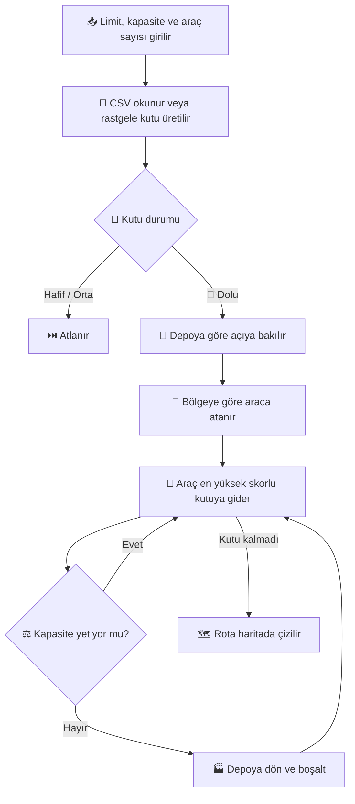

[README_NetBeans.md](https://github.com/user-attachments/files/33901652/README_NetBeans.md)

<div align="center">

# 🚛 Akıllı Çöp Toplama Rota Planlayıcı

### Java & Swing ile geliştirilmiş akıllı rota simülasyonu ♻️


</div>

---

## 🌍 Proje Hakkında

Şehirdeki çöp kutularının hepsini her gün gezmek hem zaman hem yakıt kaybıdır. Bu proje **sadece dolu olan kutuları** tespit eder, bunları birden fazla araca **bölge bölge** paylaştırır ve her araç için **kapasiteye uygun, kısa bir rota** planlar. Sonuç hem konsolda hem de renkli bir harita penceresinde gösterilir.

---

## ✨ Özellikler

| | Özellik | Açıklama |
|---|---|---|
| 🚦 | **Akıllı sınıflandırma** | Kutular, girilen limite göre Hafif / Orta / Dolu olarak ayrılır |
| 🚚 | **Çoklu araç desteği** | 1 ile 5 arası araçla çalışır |
| 🧭 | **Bölge bazlı dağıtım** | Kutular depoya göre açıya bakılarak araçlara paylaştırılır |
| ⚖️ | **Kapasite kontrolü** | Araç dolunca depoya döner, boşaltır, yeni sefer başlar |
| 🗺️ | **Renkli harita** | Her aracın rotası farklı renkte çizilir |
| 📄 | **CSV desteği** | Kendi verini yükleyebilir ya da rastgele kutu üretebilirsin |

---

## 🎨 Harita Renk Rehberi

| Renk | Anlamı |
|:---:|---|
| 🔴 | **Dolu**: toplanacak kutu |
| 🟠 | **Orta**: yarıdan fazla dolu, henüz toplanmaz |
| 🟢 | **Hafif**: boş sayılır |
| ⬛ | **Depo (D)**: haritanın ortasında (25, 25) |
| 🔵🟣🟦🌸🟤 | **Araç rotaları**: her araç ayrı renk |

---

## 🧠 Nasıl Çalışıyor?



**1️⃣ Sınıflandırma:** `ağırlık ≥ limit` ise 🔴 DOLU, `ağırlık ≥ limit / 2` ise 🟠 ORTA, diğerleri 🟢 HAFIF.

**2️⃣ Bölge bazlı dağıtım (Sweep):** Depo merkez kabul edilir. Her dolu kutunun depoya göre açısı hesaplanır ve daire, araç sayısı kadar eşit dilime bölünür. Her dilim bir araca verilir, böylece araçlar birbirinin yoluna girmez.

**3️⃣ Rota planlama (Greedy):** Her araç bir sonraki kutuyu şu skorla seçer:

```
skor = kutunun ağırlığı / (mesafe + 1)
```

Yani yakın ve ağır kutular öncelikli olur. Araca sığmayan kutu atlanır, araç dolarsa depoya dönüp yeni sefer başlar.

---

## 🚀 Kurulum ve Çalıştırma

**Gereksinimler:** JDK 8 veya üzeri

Önce projeyi indir: **Code → Download ZIP** ile indirip klasöre çıkar.

---

## 📄 CSV Formatı

Dosya şu sırayla, virgülle ayrılmış olmalı: `id, x, y, ağırlık`

```csv
id,x,y,agirlik
1,10,15,42
2,35,8,18
3,22,40,50
```

- Koordinatlar **0 ile 50** arasında olmalı.
- Başlık satırı varsa otomatik atlanır.

---

## 🗂️ Proje Yapısı

```
📦 Proje
 ┣ 📁 src          → Main.java (tüm program)
 ┣ 📁 nbproject    → NetBeans ayarları
 ┣ 📜 build.xml
 ┣ 📊 kutular.csv  → Örnek veri
 ┗ 📘 README.md
```

| Sınıf | Görevi |
|---|---|
| `CopKutusu` | Konum, ağırlık, durum ve renk bilgisi |
| `Arac` | Atanan kutular, yol, yük ve toplam mesafe |
| `HaritaPanel` | Swing ile harita ve açıklama çizimi |
| `Main` | CSV okuma, dağıtım, rota planlama, program akışı |

---

## 🔮 Gelecek Planları

- [ ] Daha gelişmiş rota algoritması (2-opt)
- [ ] Gerçek harita üzerinde gösterim
- [ ] Rotayı resim olarak kaydetme
- [ ] Konsol yerine form ile veri girişi

---

<div align="center">

### 👩‍💻 Geliştirici

**Zeynep** · [@zeynep-eng-dev](https://github.com/zeynep-eng-dev)

⭐ Projeyi beğendiysen yıldız vermeyi unutma!

</div>
